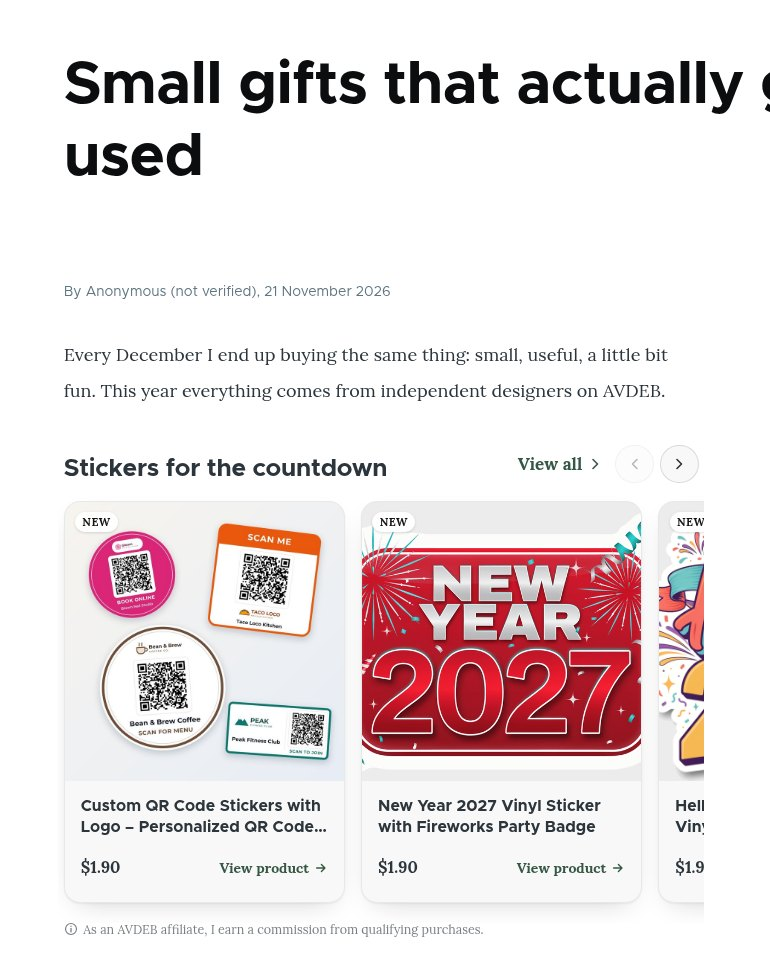

# AVDEB Products

Show [AVDEB](https://avdeb.com/developers/#drupal) products on your Drupal site (a creator's shop, a category, a search or a single product) with **your affiliate referral code on every link**.



- **In content:** type `{avdeb-products https://avdeb.com/category/stickers/ layout="carousel"}` in any body field. The *AVDEB product tags* filter is turned on in Basic HTML and Full HTML when you install the module.
- **As a block:** place *AVDEB Products* in any region (sidebar, footer, front page) under *Structure → Block layout*.
- **Four layouts:** grid, carousel (scroll-snap with keyboard and arrow buttons), list ("shop the post") and spotlight. Single products render as a horizontal card, a hero or a compact card, with your own badge and note.
- **Fits your theme:** container queries let embeds adapt to the column they sit in. Choose inherit, light, dark or system theme, plus card style, accent colour, radius and image shape. Styles use `:where()` (zero specificity), so your theme's CSS always wins, and `--avdeb-*` custom properties restyle everything.
- **Fast and resilient:** products are fetched on the server and cached in their own cache bin (database, Redis or Memcache). If AVDEB can't be reached, the last good copy is served for a week. Embeds carry render-cache tags and max-age, and *Refresh products now* invalidates them.
- **Honest links:** referral links get `rel="sponsored"`, and an optional affiliate disclosure appears under embeds that carry a code.
- **Private by default:** no third-party scripts, cookies, iframes or tracking. The only JavaScript is a small Drupal behavior for the carousel arrows. The secret key stays on the server.

## Requirements

- Drupal 10.3 or 11
- PHP 8.1+ (the `intl` extension gives localised prices; without it prices use a simple format)
- Core Filter and Block modules

## Installation

```sh
composer require drupal/avdeb
drush pm:install avdeb
```

Or download the release, put it in `modules/contrib/avdeb` and enable *AVDEB Products* under *Extend*.
See [Installing Drupal modules](https://www.drupal.org/docs/extending-drupal/installing-modules).

## Configuration

*Configuration → Content authoring → AVDEB Products* (`/admin/config/content/avdeb`, permission *Administer AVDEB Products*):

- **Referral code:** added as `?ref=` to every AVDEB link.
- **Secret key** (optional, `avdeb_sk_…`): your code is added automatically and embeds can show up to 48 products (12 without a key). The key is never shown again after saving.
- **Display defaults:** layout, columns, card style, colour theme, accent colour, corner radius, image shape, button text, prices, designer names, badges, new tab.
- **Affiliate disclosure** and **caching** (refresh interval, *Refresh products now*).

The status line at the top shows whether links are credited to you ("Connected as …", the code in use, request stats).

### Become an AVDEB affiliate

Free to join: 5% commission, 30-day cookie, monthly PayPal payouts in USD ($50 minimum), open worldwide.
Apply at [avdeb.com/affiliate/apply](https://avdeb.com/affiliate/apply/). After approval, copy your referral code (or create a secret key) in the [partner dashboard](https://avdeb.com/affiliate/dashboard/developers/) and paste it on the settings page.

## Usage

### Tags in content

```text
{avdeb-products https://avdeb.com/creators/cleo/ layout="carousel" limit="8" heading="From my shop"}
{avdeb-products https://avdeb.com/category/stickers/ layout="list" limit="3"}
{avdeb-products cat stickers columns="4"}
{avdeb-product https://avdeb.com/store/cat-sticker/ variant="hero" badge="Editor's pick" note="I use it every day."}
{avdeb-button href="/creators/cleo/" label="Visit my shop" variant="outline" align="center"}
```

The first value is a creator, category or product link (detected automatically) or search words. Options:
`layout` (grid, carousel, list, spotlight), `limit`, `columns`, `heading`, `intro`, `card-style` (elevated, outline, minimal),
`theme` (site, light, dark, auto), `accent`, `radius`, `ratio` (square, portrait, landscape), `button-text`, `hide-price`, `hide-creator`, `view-all`,
`heading-level`. For a single product: `variant` (horizontal, hero, card), `badge`, `note`.

A tag alone in a paragraph replaces the whole paragraph. Write `{{avdeb-products}}` to show a tag as text. To use tags in another text format, enable *AVDEB product tags* in that format's settings (*Configuration → Text formats and editors*).

### Block

*Structure → Block layout → Place block → AVDEB Products*: link or search, layout, number of products, columns, heading, card style and theme.

### Styling

Every rule is `:where()`-wrapped, so theme CSS wins. Set tokens in your theme:

```css
.avdeb {
  --avdeb-accent: #7c3aed;
  --avdeb-radius: 4px;
  --avdeb-card-bg: #fff;
  --avdeb-font-title: Georgia, serif;
}
```

Tokens: `--avdeb-accent`, `--avdeb-accent-contrast`, `--avdeb-surface`, `--avdeb-card-bg`, `--avdeb-card-pad`, `--avdeb-border`, `--avdeb-muted`,
`--avdeb-badge-bg`, `--avdeb-badge-text`, `--avdeb-shadow`, `--avdeb-shadow-hover`, `--avdeb-radius`, `--avdeb-ratio`, `--avdeb-gap`, `--avdeb-pad`,
`--avdeb-font-title`, `--avdeb-heading-size`, `--avdeb-title-size`, `--avdeb-price-size`, `--avdeb-btn-bg`, `--avdeb-btn-color`, `--avdeb-btn-shadow`.
To replace the stylesheet entirely, use `libraries-override` for `avdeb/embed` in your theme's `.info.yml`.

## How it works

- The filter and block call `https://api.avdeb.com/v1/catalog/products` from the server (Guzzle). With a secret key, requests send `Authorization: Bearer avdeb_sk_…` and the API returns links that already carry your code; without one, `?ref=` is added to every link.
- Responses are cached per query in the `avdeb` cache bin. A failed request serves the last good result (up to a week old) and retries after 15 minutes; at most 30 API calls a minute are made.
- Rendered embeds are cached with the `avdeb_products` and `config:avdeb.settings` cache tags and a max-age equal to the refresh interval. (Drupal's anonymous *Internal Page Cache* ignores max-age; *Refresh products now* or a cache rebuild updates those pages.)
- All product data is validated before rendering: only `https://avdeb.com` links and `https://` images get through, and every value is escaped.

## Development

```sh
php tests/run.php            # unit tests for the catalog client, options and renderer (no Drupal needed)
tests/dev-site.sh            # throw-away Drupal 11 site in Docker with the module enabled → http://localhost:8090
```

## Maintainers

- AVDEB, <https://avdeb.com/developers/>

## License

GPL-2.0-or-later
